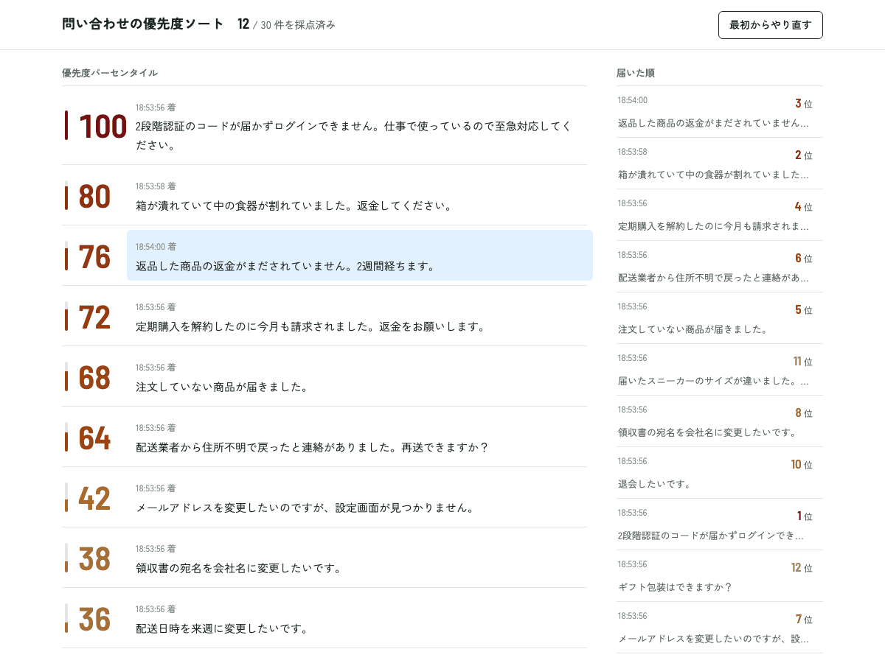
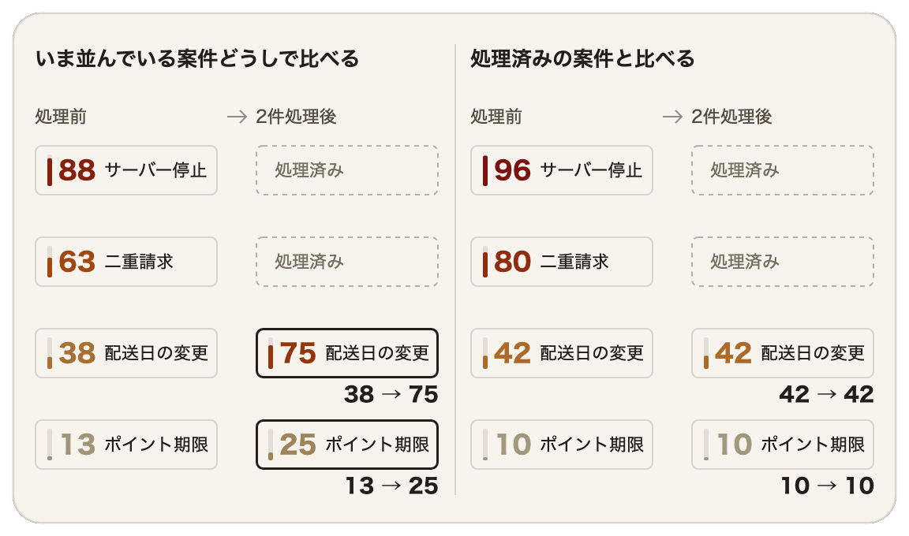

# percentile-ranked triage

percentile-ranked triage は、System One model（短時間かつ低コストで判断を出力するAIモデル）を使用し、対処すべき大量の案件を優先度の高い順に並べ、緊急性の高い案件をわかりやすく伝える仕組みです。ここでは、この仕組みを作った経緯と、[実際の業務に組み込むうえで見えてきた課題](#見えてきた課題)を紹介します。

<picture>
  <source media="(prefers-color-scheme: dark)" srcset="docs/images/demo_dark.gif">
  
</picture>

案件が届くたびに優先度を判断し、優先度に合わせた位置に差し込みます。左の数字と色は優先度を表しています。採点が済んで差し込まれた案件は、数秒間、背景が青くなります。

## 成果物

成果は、percentile-ranked triage という仕組みです。この仕組みを、役割の違う3つのファイルに残しました。

| 成果物 | 役割 | 内容 |
|---|---|---|
| [実装ガイド](docs/percentile_ranked_triage_guide.md) | percentile-ranked triage を組み込むための方針 | 緊急度の質問の仕方、各分類段階の確率から並び順を決める方法、処理済みの過去の案件と比べて優先度の高さを示す方法、色での見せ方、運用の注意 |
| [実験報告書](docs/report_experiments.md) | 実装ガイドの根拠 | 回答速度、質問の仕方、実データ（Kubernetes の issue）、判断材料の自己申告、表示について行った実験と、その結果 |
| [デモ](demo/) | 仕組みが画面で機能するかの確認 | 問い合わせが届くたびに decider-0.8b で採点し、優先度の高い順の位置に差し込む画面です。冒頭の画像はこのデモです |

## 経緯

### 1. System One model を自分の手で試す

2026年9月、TypeSafe が System One model の Jev を公開しました。Jev に「『雪だるまを作った』の季節は、春・夏・秋・冬のどれか」と尋ねると、「冬 62%、秋 20%、春 12%、夏 7%」のように、選択肢ごとの確率で答えることができます。確率がすぐに返ってくるので、大量の案件を、急ぐ順に並べるのに使えるのではないかと考え、オープンウェイトの System One model である decider（0.8b・2b・4b）を手元の PC で動かして、確かめることにしました。

### 2. 並べ替えには、正答率より並び順を使う

decider の評価を始めるにあたり、次の3つを準備しました。

- EC の問い合わせ30件と、担当部署、返金要求の有無、緊急度の想定正解をまとめた評価データ。
- 担当部署、返金要求の有無、緊急度の3つを decider に尋ねるための問いの文と、選択肢や各分類段階の説明。
- 問い合わせごとに decider に尋ね、回答を想定正解と照らし合わせる採点スクリプト。

| 問い合わせ | 担当部署 | 返金要求 | 緊急度 |
|---|---|---|---|
| 明日のイベントで使うので今日中に届かないと困ります！追跡番号も反応しません。 | 配送 | なし | 高い |
| 同じ注文で2回引き落とされています。1回分を返金してください。 | 請求 | あり | 中くらい |
| 届いたスニーカーのサイズが違いました。交換できますか？ | 返品 | なし | 低い |
| 新商品の入荷予定を教えてください。 | その他 | なし | 低い |

<sub>評価データの一部です（30件中4件）。</sub>

評価データを使用し、案件が届くたびに採点しても十分な速度が出るかも確かめました。まず初期状態の回答速度を測って基準にし、float16、問いをまとめてではなく1つずつ送る方法、MPS 向けの最適化を個別に試しました。問いを1つずつ送ると速くなり、decider-4b では回答も変わりませんでした。decider-4b は連続して処理するうちに遅くなりましたが、ファンのない PC 本体が明らかに熱くなっていたので、熱で速度が落ちたのだと考えています。

最初の結果では、decider-4b でも緊急度の正答率は70%と低い結果でした。正答率だけを見ると、緊急度の判定は苦手なように見えます。しかし、並べ替えに使うなら、注目すべきは分類段階が一致したかではなく、並び順が正しいかだと考えました。そこで、評価に順序一致率を加えました。順序一致率は、想定正解の分類段階が違う2件の組のうち、優先度スコア（各分類段階の確率から求めた期待値）の並び順が想定正解の並び順と一致した割合です。decider の回答が想定正解と無関係である場合、順序一致率は50%に近い結果になります。

| モデル | 1件あたりの時間 | 正答率 | 順序一致率 |
|---|---|---|---|
| decider-4b | 690ms | 70.0% | 97.9% |
| decider-2b | 304ms | 56.7% | 95.1% |
| decider-0.8b | 209ms | 66.7% | 95.1% |

<sub>評価データ30件、緊急度3段階。時間は、3つの問いを1つずつ送った場合の中央値です。</sub>

順序一致率に着目すると、decider の3サイズ（0.8b・2b・4b）のすべてで、95%以上の組の並び順が正しくなりました。回答速度には約3倍の差があったのに、並び順では3サイズの間の差はほとんどありませんでした。不正解の多くは、隣の分類段階への外れでした。

decider-4b でも正解できない案件について、自分でも緊急度を判断してみました。すると、私の回答は、想定正解とも decider の回答とも割れました。ここで、想定正解は評価データを作成した Claude Opus の判断にすぎないことに気づきました。そこから、データ上の想定正解との不一致には decider の性能の問題だけでなく、AI 以前から人どうしで自然に起こっていた判断の違いも含まれていると考えるようになりました。

### 3. 質問の仕方で変わるのは、並び順ではなくスコアの散らばり

優先度を色で人に分かりやすく、しかも数理的にも正しく伝えるには、値が一部に偏らず、散らばっている必要があります。そこで、同じ評価データで、質問の仕方を変えて比較しました。

- ラベルの言語（日本語・英語・中国語・トルコ語・アラビア語）
- 分類段階を数字で表すか、言葉で表すか
- 分類段階の数（数字では3〜7段階、言葉では3〜5段階）と、各分類段階の説明の有無

アラビア語を除き、質問の仕方を変えたいずれの場合でも、優先度の並び順にほとんど変化はありませんでした。一方、変化が起きたのは、正規化した優先度スコアの散らばり具合でした。


<sub>評価データ30件、decider-0.8b を使用。</sub>

- 分類段階を数字で表すと、7段階に増やしてもスコアは狭い範囲に固まりました。言葉で表すと、大きく分散しました。decider の回答は、数字という一見客観的な分類よりも、恣意を含んだ言葉で尋ねたときのほうが分散しました。
- 各分類段階に説明を付けると、分類段階の数によらず、想定正解「高」と想定正解「低」のスコアがはっきり分かれました。

どちらも、私にとって大きな発見でした。特に2つ目からは、percentile-ranked triage を組み込むとき、工夫の余地が大きいのは意外にも分類段階の説明をどう書くかだと考えるようになりました。この考えは実装ガイドの方針にも反映しています。

標準の質問の仕方は、次の「説明付きの3段階」にしました。

```
問い：この問い合わせの緊急度は？
段階：低い：急ぎではない ／ 中くらい：数日以内に対応 ／ 高い：今すぐ対応が必要
```

### 4. スコアを順位に変換し、処理済みの案件と比較する

経緯3の結果を受け、優先度スコアをそのまま使わず、過去の案件の中での順位（優先度パーセンタイル）に変換することにしました。順位を使用することで、スコアが狭い範囲に固まっている場合も、値を0〜100に分散させることができます。


- **優先度スコア**：分類段階の番号（0, 1, 2）と各分類段階の確率との期待値です。案件の並べ替えに使用します。
- **優先度パーセンタイル**：優先度スコアが、基準集合の中でどのくらい上かを0〜100で表した値です。数値と色で伝えます。
- **基準集合**：比較の基準となる、処理済みの過去の案件です。新しく処理した案件を取り込みます。

パーセンタイルを考えるにあたり、比較対象を何とするかは重要な問題です。対処中の案件の間で順位を決めると、均等なパーセンタイルと単純なグラデーションが現れるだけになってしまいます。何より、緊急の案件を処理した時、残った緊急性の低い案件の順位が繰り上がり、優先度と対応しない意味で赤色が使われることになり、それは色への信頼が失われることを意味します。一方、処理済みの案件のストックと比較すれば、緊急の案件を処理しても、残った案件の値が繰り上がることはありません。



### 5. 案件本文だけでは判断材料が足りない

評価データで仕組みが整ったので、実践に近いデータに使用してみました。実際に人が設けた優先度があり、時系列も追えるデータとして、Kubernetes の issue を選びました。メンテナーが5段階の優先度ラベルを付けた issue を50件集め、ラベルと比べました。

順序一致率は、decider-2b・decider-4b でも約62%と低い結果でした。decider-0.8b は51.7%と、偶然とほぼ変わりません。

| モデル | 評価データ30件 | Kubernetes の issue 50件 |
|---|---|---|
| decider-4b | 97.9% | 61.9% |
| decider-2b | 95.1% | 61.6% |
| decider-0.8b | 95.1% | 51.7% |

<sub>順序一致率。緊急度3段階・説明付き。</sub>

ここからは、試行錯誤が実を結ばない時間が続きました。リリース計画や担当者の状況などの、案件本文に載っていない情報が優先度を左右する場合は、decider が正しく判断できないのではないかと考え、件数を100件に増やしました。そこで、decider 自身に「本文だけでは判断材料が足りないか」を一件ずつ回答させました。しかし、結果は仮説と真反対のものでした。decider の回答は本文の短さと相関しているだけで、どの案件が不正解になるかを見分ける手がかりにはなりませんでした。

この腕試しで最も大切な気づきは、decider が正しく判断するには、判断に必要な背景情報を十分に渡す必要があるということです。

### 6. 優先度を色で伝える

経緯4で組み立てた仕組みが、人が見て瞬時に理解できる表示になるかを、デモで確かめました。評価データの問い合わせ30件のうち、最初に表示されない20件を1〜2.5秒おきに不規則に追加し、届くたびに decider-0.8b で採点して、優先度の高い順の位置に差し込みます。各案件の優先度パーセンタイルは、数値と、その値に応じた色、数値左側の縦に細い目盛りで示しました。

色には OKLCH を使用しました。OKLCH は、数値の差が人の目に見える明るさや鮮やかさの差にそろうように作られた色の表し方です。優先度の低い案件はくすんだカーキ、中ほどは琥珀、高い案件は赤になるよう色を割り振り、0〜100のどこでも、隣り合う値の見た目の差が等間隔になるようにしました。


採点は1件数百ms で、届くとほぼ同時に案件一覧に反映されました。処理済みの案件と比べる仕組みにしたので、案件が届いても処理されても、すでに並んでいる案件の数値と色は変わりません。

### 7. 成果のまとめ

デモまで作ったところで、ここまでの知見を残す形を考えました。

まず、知見を整理しやすいよう、この仕組みに名前を付けました。よく知られた呼称がないかを調べたうえで、医療で緊急度に応じて対応の順番を決める triage という言葉を借り、「percentile-ranked triage」としました。

そのうえで、知見を2つのファイルに分けて残しました。

- **実装ガイド**：組み込む人が、何をすればよいかだけを読めるようにしました。実験データや経緯は入れず、質問の仕方から色での見せ方、運用の注意までの方針に絞っています。経緯5の気づき（背景情報が足りない案件は、情報を一緒に渡すか、並べたあとに人が判断する）も、運用の注意に含めました。
- **実験報告書**：実装ガイドの根拠を残し、実験を引き継げる形にしました。その場その場で進めてきた実験を、あとから回答速度、質問の仕方、実データ、判断材料の自己申告、表示の5つの問いに整理し直し、それぞれ何が分かって何が分かっていないかを書いています。

## 見えてきた課題

- **案件本文だけで優先度を判断できないトリアージ。**\
  Kubernetes の issue では、メンテナーが付けたラベルとの一致率が大きく下がりました。私は当初、AI 同士のエスカレーションのように、必要な情報がすべて案件本文に含まれている使い方を想定していました。しかし、Kubernetes の issue ではその前提が成り立ちません。トリアージには、案件本文だけで優先度を判断できる場合と、そうでない場合があります。
- **System One model に尋ねる内容には工夫の余地が大きい。**\
  組み込みたいワークフローの性質に応じて、背景情報が案件本文に含まれるよう問い合わせフォームの仕様を変更する、分類段階の説明を実際の場面での優先度判断基準に合わせた文言に変える、といった工夫が精度を左右します。
- **背景情報不足による System One model の限界。**\
  背景情報を案件本文に盛り込めない場面は、低コストなモデルでは対応しきれません。こうしたタスクは、大規模言語モデルを用いる AI エージェントに任せ、役割を分担することを考えるべきです。System One model をどこまでのタスクに活用するかは、費用・時間と、知識・裁量のトレードオフで決まります。
- **想定正解は Claude Opus の判断にすぎない。**\
  順序一致率も、言葉・3段階（説明付き）を標準に選んだ根拠も、想定正解との一致度に基づいています。そのため結果は、評価データを作成した Claude Opus の判断に大きく左右されます。実際、Opus が作成した想定正解と私の判断の間にも、少なからず食い違いがありました。より信頼できる結果を得るには、導入先の業務をいくつかの類型に分け、類型ごとに実務者が想定正解を作成することが考えられます。

## ファイル構成

```
docs/          実験報告書・実装ガイド・図
demo/          デモのサーバーと画面
experiments/   回答速度・質問の仕方・実データ・判断材料の自己申告を確かめたスクリプト
data/          日本語の問い合わせ30件、基準集合50件、問いの定義
results/       各実験の結果
```

Kubernetes の issue の本文は含めていません。`python experiments/fetch_k8s.py` で集め直せます。
