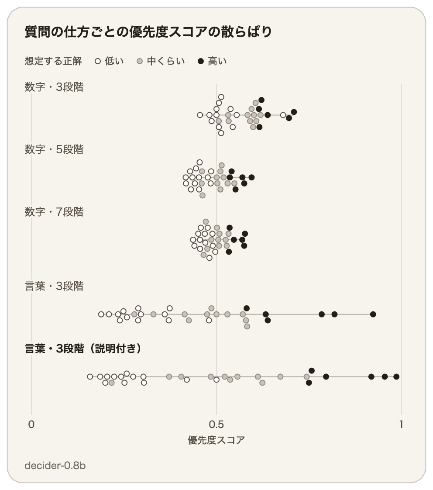
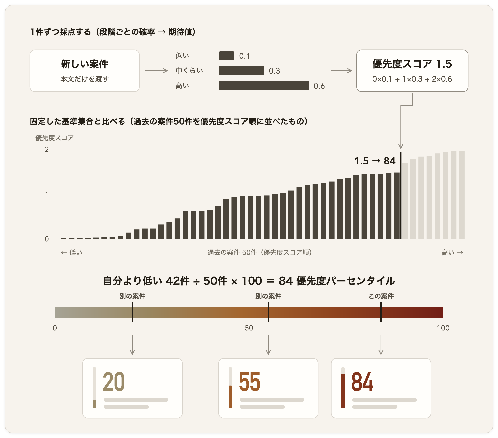
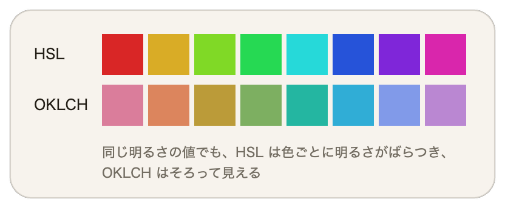

# percentile-ranked triage

System One model（短時間かつ低コストで判断を出力するAIモデル）を使用し、対処すべき大量の案件を優先度の高い順に並べ、緊急性の高い案件をわかりやすく伝えます。その仕組みを作るまでの経緯と、[実際の業務に組み込むうえで見えてきた課題](#見えてきた課題)です。

<picture>
  <source media="(prefers-color-scheme: dark)" srcset="docs/images/demo_dark.gif">
  
</picture>

案件が届くたびに優先度を判断し、優先度に合わせた位置に差し込みます。左の数字と色の濃さは優先度を表しています。

## 成果物

成果は、percentile-ranked triage という仕組みです。この仕組みを、役割の違う3つのファイルに残しました。

| 成果物 | 役割 | 内容 |
|---|---|---|
| [実装ガイド](docs/percentile_ranked_triage_guide.md) | percentile-ranked triage を組み込むための方針 | 緊急度の質問の仕方、各段階の確率から並び順を決める方法、固定した過去の案件と比べて優先度の高さを示す方法、色での見せ方、運用。実験データや経緯は含めない |
| [実験報告書](docs/report_experiments.md) | 実装ガイドの根拠 | 速度、質問の仕方、実データ（Kubernetes の issue）、モデルの自己申告、表示の5つの問いについて、何を測り、何が分かり、何が分かっていないか |
| [デモ](demo/) | 仕組みが画面で機能するかの確認 | 問い合わせが届くたびに decider-0.8b で採点し、優先度の高い順の位置に差し込む画面。冒頭の画像がこの画面 |

## 経緯

### 1. decider をローカルで動かす

2026年9月、TypeSafe が Jev を公開しました。Jev は System One model の代表例です。Jev に「『雪だるまを作った』の季節は、春・夏・秋・冬のどれか」と尋ねると、「冬 62%、秋 20%、春 12%、夏 7%」のように答えます。

Jev は公開直後から大きな話題になり、オープンウェイトのモデルで再現するプロジェクトやベンチマーク、さまざまな応用例が次々に現れました。私は、オープンウェイトの System One model である decider（0.8b・2b・4b）をローカル環境で動かし、自分でも振る舞いを観察し始めました。

### 2. 並べ替えには、正答率より並び順を使う

decider の評価を始めるにあたって、次の3つを準備しました。

- EC の問い合わせ30件と、担当部署・返金要求の有無・緊急度の想定正解をまとめた評価データ。
- 担当部署・返金要求の有無・緊急度の3つを decider に尋ねるための問いの文と、選択肢や各段階の説明。
- 問い合わせごとに decider に尋ね、答えを正解と照らし合わせる採点スクリプト

評価データの一部です（30件中4件）。

| 問い合わせ | 担当部署 | 返金要求 | 緊急度 |
|---|---|---|---|
| 明日のイベントで使うので今日中に届かないと困ります！追跡番号も反応しません。 | 配送 | なし | 高い |
| 同じ注文で2回引き落とされています。1回分を返金してください。 | 請求 | あり | 中くらい |
| 届いたスニーカーのサイズが違いました。交換できますか？ | 返品 | なし | 低い |
| 新商品の入荷予定を教えてください。 | その他 | なし | 低い |

評価データを使って、案件が届くたびに採点しても間に合う速さかも確かめました。まず工夫なしの速さを測って基準にし、float16、問いを1つずつ送る方法、MPS 向けの最適化を個別に試しました。問いを1つずつ送ると速くなり、decider-4b では答えも変わりませんでした。decider-4b は使ううちに遅くなりましたが、ファンのない本体が明らかに熱くなっていたので、熱で速度が落ちたのだと考えています。

最初の結果では、decider-4b でも緊急度の正答率は70%でした。正答率だけを見ると、緊急度の判定は苦手に見えます。しかし、並べ替えに使うなら、見るべきは段階が一致したかではなく、並び順が正しいかだと考えました。そこで、評価に順序一致率を加えました。順序一致率は、正解の段階が違う2件の組のうち、優先度スコアの大小が正解の大小と一致した割合です。decider の返答が正解と無関係なら、順序一致率は50%に近くなります。

| モデル | 1件あたりの時間 | 正答率 | 順序一致率 |
|---|---|---|---|
| decider-4b | 690ms | 70.0% | 97.9% |
| decider-2b | 304ms | 56.7% | 95.1% |
| decider-0.8b | 209ms | 66.7% | 95.1% |

<sub>評価データ30件、緊急度3段階。時間は、3つの問いを1つずつ送った場合の中央値です。</sub>

順序一致率で見ると、decider の3サイズとも95%以上の組で並び順が正しくなりました。速度には約3倍の差があったのに、並び順ではサイズによる差はほとんどありませんでした。段階を外した案件の大半は、隣の段階への外れでした。

decider-4b でも外れが残る案件を、自分でも解いてみました。すると、想定正解とも decider とも答えが割れました。想定正解は評価データを作成した Claude Opus の判断にすぎないことに気づきました。そこから、データ上の不正解には decider の性能の問題だけでなく、AI 以前から人どうしで自然に起こっていた判断の違いも含まれていると考えるようになりました。

### 3. 質問の仕方で変わるのは、並び順ではなくスコアの分散度合い

同じ評価データで、質問の仕方を変えて比べました。このときの問題意識は、優先度スコアが狭い範囲に固まらないよう、どうばらけさせるかでした。

- ラベルの言語（日本語・英語・中国語・トルコ語・アラビア語）
- 段階を数字で表すか、言葉で表すか
- 段階の数（数字では3〜7段階、言葉では3〜5段階）と、各段階の説明の有無

アラビア語を除き、分類段階を変更したいずれの場合でも、優先度の並び順にほとんど変化はありませんでした。一方、変化が起きたのは、優先度スコアの分散度合いでした。



- 段階を数字で表すと、7段階に増やしてもスコアは狭い範囲に固まりました。言葉で表すと、大きく広がりました。decider は数字という一見客観的な分類よりも、恣意の入った言葉で尋ねたときのほうが答えを散らしました。
- 各段階に説明を付けると、段階の数によらず、正解「高」と正解「低」のスコアがはっきり分かれました。

どちらも、私にとって大きな発見でした。特に2つ目からは、percentile-ranked triage を別の分野に組み込むとき、工夫の余地が大きいのは意外にも段階の説明の書き方だと考えるようになりました。この考えを実装ガイドの方針にも反映しています。

標準の質問の仕方は「説明付きの3段階」にしました。

```
問い：この問い合わせの緊急度は？
段階：低い：急ぎではない ／ 中くらい：数日以内に対応 ／ 高い：今すぐ対応が必要
```

この結果を受けて、質問の仕方で decider の出力を変えるのではなく、出力を後から処理することで、優先度スコアをばらけさせられないかと考えるようになりました。これが次の仕組みの設計につながります。

### 4. スコアを順位に直し、常に過去の案件と比較する

このころ、私の関心は判定の精度から、人にどう見せるかに移っていました。緊急性を色の濃さで表したいと考えていました。人に分かりやすく、しかも数理的にも正しく伝えるには、値が一部に偏らず、一様に近く散らばっている必要があります。

経緯3の結果を受けて、優先度スコアを後から順位に直す方法を選びました。並べ替えに強いスコアの付け方（説明付きの3段階で尋ね、期待値をとる）はすでに整理できていたので、新たなこだわりは持たず、そのまま使いました。順位で決まる値なら、スコアが狭い範囲に固まっていても0〜100に広がります。



- **優先度スコア**：段階番号（0, 1, 2）に各段階の確率を掛けて合計した値（期待値）です。案件の並べ替えに使います。最も確率の高い段階だけを使うと同点が増え、並べられなくなります。
- **優先度パーセンタイル**：優先度スコアが、基準集合の中でどのくらい上かを0〜100で表した値です。数値と色の濃さで見せます。
- **基準集合**：比べる相手として固定した、過去の案件です。

比べる相手を何にするかは、パーセンタイルを考え始めた時点から意識していました。いま並んでいる案件どうしで比べると、色は並び順の上から下へ単純なグラデーションを塗るのと変わらず、並べ替え以上のことを伝えません。値も、並んでいる件数で決まる刻みにしかなりません。何より、急ぎの案件を処理すると、残った緊急性の低い案件の順位が繰り上がって強く色づき、圧迫感が出ます。処理済みの案件も含めた固定の基準集合と比べれば、同じ値はいつ見ても同じ意味になります。


### 5. 案件本文だけでは判断材料が足りない

評価データで仕組みが整ったので、実戦に近いデータで腕試しをしました。人が実際に付けた優先度があり、時系列も追えるデータとして、Kubernetes の issue を選びました。メンテナーが5段階の優先度ラベルを付けた issue を50件集め、ラベルと比べました。

順序一致率は、decider-2b・decider-4b でも約62%まで下がりました。decider-0.8b は51.7%で、偶然とほぼ変わりません。

| モデル | 評価データ30件 | Kubernetes の issue 50件 |
|---|---|---|
| decider-4b | 97.9% | 61.9% |
| decider-2b | 95.1% | 61.6% |
| decider-0.8b | 95.1% | 51.7% |

<sub>順序一致率。緊急度3段階・説明付き。</sub>

ここからは、試行錯誤が実を結ばない時間が続きました。リリース計画や担当者の状況など、案件本文には載っていない情報が優先度を左右する場合は、decider が正しく判断できないのではないかと考え、件数を100件に増やして、decider 自身に「本文だけでは判断材料が足りないか」を答えさせました。結果は仮説と逆向きでした。decider の答えは本文の短さに連動しているだけで、外れる案件の目印にはなりませんでした。

この腕試しでいちばん大事な気づきは、decider が正しく判断するには、判断に必要な背景情報を十分に渡す必要があるということです。

### 6. 優先度を色の濃さで伝える

次に、求めた優先度を人が瞬時に理解するにはどうすればいいかを考えました。経緯4で組み立てた仕組みが、人が見て使える表示になるかを、デモで確かめました。評価データの問い合わせ30件を数秒おきに不規則に届かせ、届くたびに decider-0.8b で採点して、優先度の高い順の位置に差し込みます。各案件の優先度パーセンタイルは、数値と、その色の濃さで示しました。

色には OKLCH を使いました。OKLCH は、数値の差が人の目に見える明るさや鮮やかさの差にそろうように作られた色の表し方です。優先度の低い案件はくすんだカーキ、中ほどは琥珀、高い案件は赤になるよう色を割り振り、0〜100のどこでも、隣り合う値の見た目の差が等間隔になるようにしました。



採点は1件数百ms で、届くとほぼ同時に一覧に反映されました。固定した基準集合と比べる仕組みにしたので、案件が届いても処理されても、すでに並んでいる案件の数値と色は変わりません。同じ色は、いつ見ても同じ優先度を表します。

### 7. 成果のまとめ

デモまで作ったところで、ここまでの知見を残す形を考えました。

まず、知見を整理しやすいよう、この仕組みに名前を付けました。すでに呼び名がないかを調べたうえで、医療で緊急度に応じて対応の順番を決める triage という言葉を借り、「percentile-ranked triage」としました。

そのうえで、知見を2つのファイルに分けて残しました。

- **実装ガイド**：組み込む人が、何をすればよいかだけを読めるようにしました。実験データや経緯は入れず、質問の仕方から色での見せ方、運用の注意までの方針に絞っています。経緯5の気づき（背景情報が足りない案件は、情報を一緒に渡すか、並べたあとに人が判断する）も、運用の注意に入れました。
- **実験報告書**：実装ガイドの根拠をなるべく残し、誰かが実験を引き継げるようにしました。その場その場で進めてきた実験を、あとから速度・質問の仕方・実データ・モデルの自己申告・表示の5つの問いに整理し直し、それぞれ何が分かって何が分かっていないかを書いています。

書いたあとは、今この README でしているのと同じように、中身を確かめては書き直しました。条件の違う結果を同じ表に並べていた箇所や、データから言える範囲を超えた結論も、そこで直しています。

## 見えてきた課題

- **実際のワークフローとのつながり**：Kubernetes の issue では、メンテナーのラベルとの一致が下がりました。ただ、本当に確かめたいのはラベルとの一致ではなく、実際のワークフローでの優先度を反映できるかどうかです。業務ごとに合わせ込むなら、問い合わせフォームを工夫して背景情報が本文に入るようにする、段階の説明を実際のワークフローに合わせて書く、といった改良が考えられます。背景情報がそもそも本文にない業務なら、それは低コストなモデルの限界で、大規模言語モデルを使う AI エージェントに任せるべき仕事なのかもしれません。どこまでを System One model に任せるかは、速さと判断の確かさのトレードオフになります。
- **評価の土台**：評価に使った正解は、AI で作った問い合わせに Claude Opus が付けた1つの判断にすぎません。質問の仕方も同じ評価データで選んでいるので、このデータに合わせ込んでいる可能性もあります。

## ファイル構成

```
docs/          実験報告書・実装ガイド・図
demo/          デモのサーバーと画面
experiments/   速度・質問の仕方・実データ・自己申告を確かめたスクリプト
data/          日本語の問い合わせ30件、基準集合50件、問いの定義
results/       各実験の結果（CSV）
```

Kubernetes の issue の本文は含めていません。`python experiments/fetch_k8s.py` で集め直せます。
